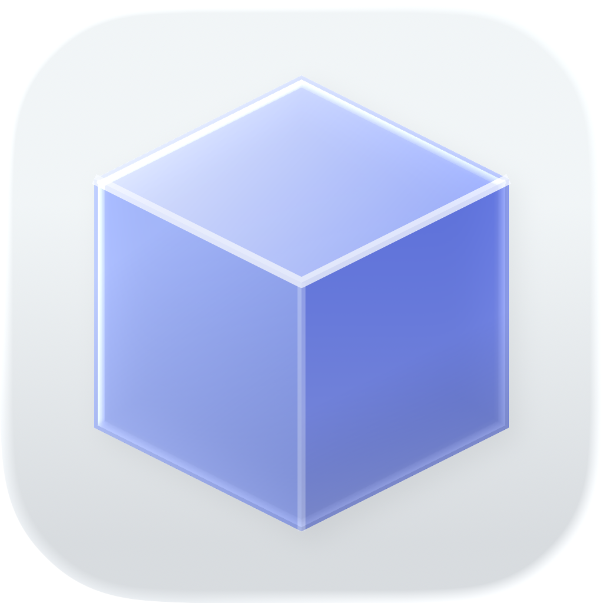

# Trace — Local-First OSINT & Intelligence Investigation Platform

<p align="center">
  
</p>

<p align="center">
  <strong>Trace</strong> is a private, local-first intelligence investigation and link analysis tool designed for OSINT analysts, researchers, and forensic investigators. All project records are stored entirely on your local machine in plain Markdown with YAML frontmatter alongside an embedded, client-side SQLite database.
</p>

---
<p align="center">
  
</p>


## Key Features

### Interactive Knowledge Graph
- **Link & Entity Analysis**: Map complex networks of people, companies, organizations, domains, IP addresses, crypto wallets, and custom nodes.
- **Physics-Driven Interactions**: Dynamic repulsion physics when dragging nodes, fluid bouncy response, and circular hover glow highlighting without boxy background wrappers.
- **Fast Node Connection**: Press <kbd>C</kbd> (or click the Connect tool) and drag between any two nodes to instantly create relationships.
- **Layout Algorithms**: Support for CoSE (force-directed), Concentric, and Breadthfirst layouts, with automatic layout position persistence across sessions.
- **Embedded Images**: Direct rendering of profile avatars and photographic evidence within graph nodes.
- **Wikilink Mentions**: Notes using `[[Target Entity]]` syntax automatically generate interactive dashed mention relationships on the graph canvas.

### Heuristic Relationship Discovery ("Find Links")
- **Automated Intelligence Scanning**: Analyze entities across your project for non-obvious correlations:
  - **Surnames**: Family connection heuristic matching patronymics and shared surnames.
  - **Contacts**: Exact normalized phone numbers and email matching.
  - **Corporate Networks**: Common corporate email domains (filtering out public mail hosts).
  - **Infrastructure**: Shared IP addresses and hosts.
  - **Organizations & Workplaces**: Common employers, companies, and locations.
  - **Unique Identifiers**: Shared tax IDs (ІПН, ЄДРПОУ), passports, Telegram handles, and vehicle plates.
  - **Attribute Mentions**: Cross-references when entity names appear inside another entity's attributes or notes.
- **Analyst-in-the-Loop Verification**: Discovered connections are initially added as `unverified` candidate relationships with a visual indicator. Analysts can review evidence, filter by confidence score, and confirm directly on the graph canvas or in bulk.

### Quick Sources & Interactive API Requester
- **OSINT Bookmarks & Presets**: Instant access to OSINT tools, registries, and search engines (VirusTotal, Shodan, Censys, Whois, OpenSanctions, etc.).
- **Live API Request Console**:
  - Send HTTP requests directly from the app (<kbd>GET</kbd>, <kbd>POST</kbd>, <kbd>PUT</kbd>, <kbd>PATCH</kbd>, <kbd>DELETE</kbd>).
  - Custom headers and formatted request body editor with JSON beautifier.
  - Native Node/Electron IPC execution (`net:request`) bypassing browser CORS limitations.
  - **Entity Linking**: Seamlessly attach API responses directly to entities as a project evidence source, formatted research note, or raw entity attribute.

### Local-First File Architecture
- **Complete Data Ownership**: No cloud sync dependencies or third-party telemetries.
- Transparent storage layout under default directory `~/Documents/trace/projects/<project-id>/` (customizable to any folder via Project Switcher or Settings):
  - `project.md`: Investigation scope, status, and Markdown briefing.
  - `entities/*.md`: Individual entity profiles with structured YAML metadata and research notes.
  - `relationships/*.md`: Directed and undirected links with confidence ratings and status flags.
  - `sources/*.md`: Evidence citations and provenance logs.
  - `notes/*.md`: Analyst field notes supporting GitHub Flavored Markdown.
  - `graph-layout.json`: Persisted spatial coordinates for graph nodes.

### Fast Full-Text Search (SQLite FTS5)
- Powered by a local WebAssembly SQLite engine.
- Instant indexed search across entity names, aliases, attributes, tags, relationships, and raw markdown contents.

### Desktop User Experience
- **Obsidian-Style Unified Titlebar**:
  - Fixed 74px safe margin for macOS window controls (traffic lights) that never clip or displace when sidebars collapse.
  - Direct sidebar toggle button (`PanelLeft`) positioned next to system controls.
  - Integrated tab strip with preview mode, pinned tabs, and context menus.
  - Compact project switcher dropdown with direct "Show in Finder" integration.
- **Flexible Workspace Panels**:
  - Resizable sidebars with drag handles and double-click reset.
  - Quick keyboard navigation for fast OSINT workflows.
  - Custom right-click context menus for all graph and tree items.

### Portable Project Archives
- One-click export to standalone `.zip` archives containing all canonical Markdown files and layout metadata.
- Seamless project import across machines.

---

## Getting Started

### Prerequisites
- **Node.js**: v18.0.0 or higher (v20+ recommended)
- **npm** or **pnpm**
- **Operating System**: macOS (Apple Silicon arm64 / Intel x64), Linux, or Windows

### Installation & Development

1. **Clone the repository**:
   ```bash
   git clone https://github.com/your-username/trace.git
   cd trace
   ```

2. **Install dependencies**:
   ```bash
   npm install
   ```

3. **Start in browser development mode**:
   ```bash
   npm run dev
   ```

4. **Start as a desktop Electron app**:
   ```bash
   npm run dev:electron
   ```

---

## Packaging & Production Builds

### Build Web Bundle
```bash
npm run build
```

### Build & Package for macOS
Generates the `.dmg` installer and `.zip` distribution in the `release/` directory:
```bash
npm run package:mac
```

To package the `.app` bundle directory directly:
```bash
npm run package:dir
```

---

## Keyboard Shortcuts

| Shortcut | Action |
| :--- | :--- |
| <kbd>Cmd/Ctrl</kbd> + <kbd>K</kbd> | Open Command Palette / Global Search |
| <kbd>Cmd/Ctrl</kbd> + <kbd>[</kbd> | Toggle Left Sidebar |
| <kbd>Cmd/Ctrl</kbd> + <kbd>]</kbd> | Toggle Right Inspector Panel |
| <kbd>Cmd/Ctrl</kbd> + <kbd>,</kbd> | Open Settings |
| <kbd>C</kbd> | Toggle Connect Mode on Interactive Graph |
| <kbd>?</kbd> | View Keyboard Shortcuts Cheat Sheet |
| <kbd>Esc</kbd> | Dismiss active modal or context menu |

---

## Project Structure

```
trace/
├── electron/              # Electron main and preload processes
│   ├── main.ts            # Window creation, native filesystem IPC handlers
│   └── preload.ts         # Secure context bridge implementation
├── src/
│   ├── components/        # Reusable UI widgets and dialogs
│   │   ├── layout/        # Header, TabBar, LeftSidebar, RightSidebar
│   │   └── modals/        # Settings, shortcuts, and entity creation dialogs
│   ├── features/          # Core investigation modules
│   │   ├── graph/         # Cytoscape integration, physics, canvas rendering
│   │   └── projects/      # Project overview and metadata editor
│   ├── services/          # Business logic and storage layer
│   │   ├── storage/       # Local-First adapters (ElectronStorage, BrowserStorage)
│   │   ├── markdownParser.ts # YAML frontmatter parser and serializer
│   │   └── sqliteIndex.ts # Embedded SQLite FTS5 WASM search indexer
│   └── types/             # Domain TypeScript definitions and schemas
├── public/                # Static SQLite WASM binaries
└── build/                 # Desktop application icons and packaging assets
```

---

## Security & Privacy

1. All investigation data stays on your local filesystem in human-readable Markdown files suitable for standard version control (`git`).
2. No background telemetries, no cloud tracking, and no external analytics.
3. Completely air-gapped capability for sensitive investigation environments.

---

## License

This project is licensed under the [MIT License](LICENSE).
